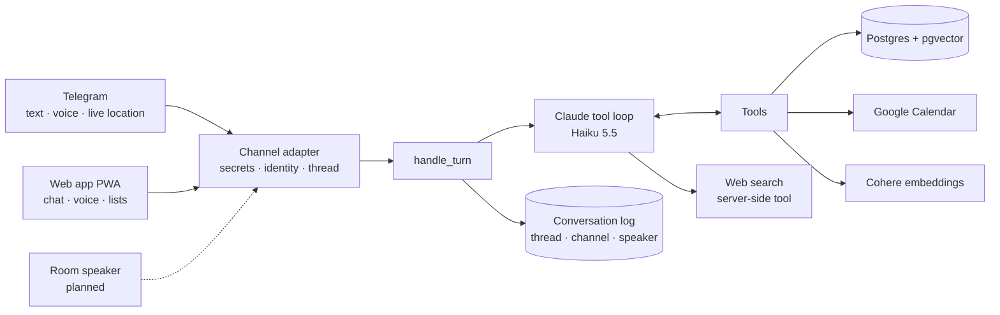

# Abdo (عبده)

A conversational household assistant that speaks **Egyptian Arabic mixed with English**,
knows everyone in the household, and does real things for them: remembers household facts,
manages a shared Google Calendar, tracks packages and the shopping list, knows who's home,
searches the web, and talks back in a Cairene voice.

It started as an assistant for my family in Cairo and now runs a four-person student suite
in Waterloo. It lives in Telegram (text and voice notes) and in its own installable web app
(chat with hold-to-talk voice, shared lists, packages, calendar). An always-on room speaker
with a custom wake word is next on the [roadmap](docs/ROADMAP.md).

<!-- TODO: demo GIF / screenshot of a mixed Arabic-English voice exchange -->

## Architecture



**Every capability is a Claude tool.** Adding a feature means adding a tool definition,
its query, and any table. The core loop never changes. Channels are thin adapters. The brain
doesn't know whether a turn came from a typed message or a voice note, apart from a flag that
keeps spoken replies short.

## Engineering decisions worth a look

- **Dates are resolved in code, not by the model.** LLMs get weekday arithmetic wrong
  ("Wednesday" → a Thursday). The model passes the day exactly as spoken ("next Friday",
  "بكرة", "7ad"), and [`calendar_svc.resolve_date`](app/calendar_svc.py) turns it into a real
  local date. Event weekdays are rendered by code too, so the model never computes one.
- **Tool failures are honest, never silent.** A degraded calendar read raises instead of
  returning "no events". An empty-but-wrong answer once led the model to create duplicate
  events. Tool errors go back to the model as explicit `ERROR:` results ("do NOT claim it
  worked"), and the model may only say "done" after a tool reports success.
- **Voice is an I/O channel, not a feature.** Speech-to-text produces text for the same brain;
  text-to-speech speaks the reply. The round trip runs as a background task after the webhook
  returns `200`, because Telegram retries slow webhooks, which caused duplicate replies.
  Replies containing digits are routed to a TTS model that normalizes numbers, and the voice
  prompt spells passwords out character by character.
- **Built for cost.** A Haiku-class model with low reasoning effort and prompt caching. The
  system prompt is split into a byte-identical persona block (cached together with the tool
  definitions, about 10K tokens) and a small per-request context block. A test guards the
  invariant, because one timestamp in the static block would silently disable every cache hit.
- **RAG that doesn't silently miss.** Facts are embedded asymmetrically (document vs query),
  deduplicated by cosine distance, and never stored without a validated 1024-dim vector.
  [`embeddings.is_valid`](app/embeddings.py) accepts pgvector's numpy arrays, a bug that once
  made every stored fact look invalid.
- **Login without passwords that works inside an installed iPhone app.** OAuth and
  magic-link redirects land in Safari instead of the home-screen app, so the web app logs in
  with a 6-digit code that Abdo DMs on Telegram. Only hashes of codes and session tokens are
  stored, the code endpoint never reveals who's a member, and five wrong tries kill a code.
- **Arabic and English in the same sentence.** Every bubble and list row lays out each line
  in its own direction (`unicode-bidi: plaintext`), and the interface is designed around a
  Cairo enamel street sign: bilingual plates, Alexandria and IBM Plex Sans Arabic.
- **Speaker-aware memory.** Conversations are keyed by thread (a DM, a group chat, later the
  shared room), and each logged turn records its channel, modality and speaker. Abdo can follow
  a group conversation and knows who asked what.

## Stack

**Backend:** Python 3.13 · FastAPI · asyncpg (raw SQL, no ORM) · Postgres + pgvector ·
Anthropic API (Claude Haiku 5.5, server-side web search) · Cohere Embed v4 · Google Calendar
API · ElevenLabs (Scribe STT, Flash TTS) · ffmpeg · web push (VAPID).
**Frontend:** React 19 · TypeScript · Vite · TanStack Query · React Router · Workbox service
worker (installable PWA).
**Deploy:** one multi-stage Dockerfile on Railway.

## Running it locally

```bash
python -m venv .venv && .venv/bin/pip install -r requirements.txt
(cd web && npm ci)
cp .env.example .env          # fill in keys; see comments in the file
psql "$DATABASE_URL" -f schema.sql
cp seed.example.sql seed.sql  # add your household, then:
psql "$DATABASE_URL" -f seed.sql
.venv/bin/uvicorn app.main:app --reload    # API on :8000
(cd web && npm run dev)                    # web app on :5173, proxies /api
```

**Demo mode** (no database or API keys; fake data, login codes printed to the terminal):
`(cd web && npm run build) && .venv/bin/python tests/demo_server.py`, then open http://localhost:8000.

Register the Telegram webhook with `scripts/set_webhook.sh https://<your-app>.up.railway.app`.

**Tests:** `.venv/bin/python tests/smoke.py` runs the turn logic, tool loop, tools, prompt
invariants, login/session security, the web API, and webhook routing offline, with every
network service and the database faked. Frontend: `cd web && npm run typecheck && npm test`.

## Project layout

```
app/
  main.py            FastAPI app, health/version endpoint, serves the web app
  channels/          channel adapters: telegram.py (webhook), web.py (/api)
  auth.py, push.py   web login (Telegram-delivered codes, sessions) and web push
  turn.py            handle_turn — the single entry point for every channel
  brain.py           Claude tool loop (model, effort, caching, refusal/fallback handling)
  prompts.py         persona (static, cached) + per-request context
  tools.py           tool definitions + dispatcher
  db.py              raw SQL queries
  calendar_svc.py    Google Calendar + deterministic date resolution
  embeddings.py      Cohere embeddings + validation
  stt.py, tts.py     ElevenLabs speech in/out
web/                 React + TypeScript PWA (pages, service worker, typed API client)
migrations/          schema changes for the live database
docs/                roadmap and phase specs (docs/egypt/ = the original family edition)
tests/               offline test suite + demo server
```
